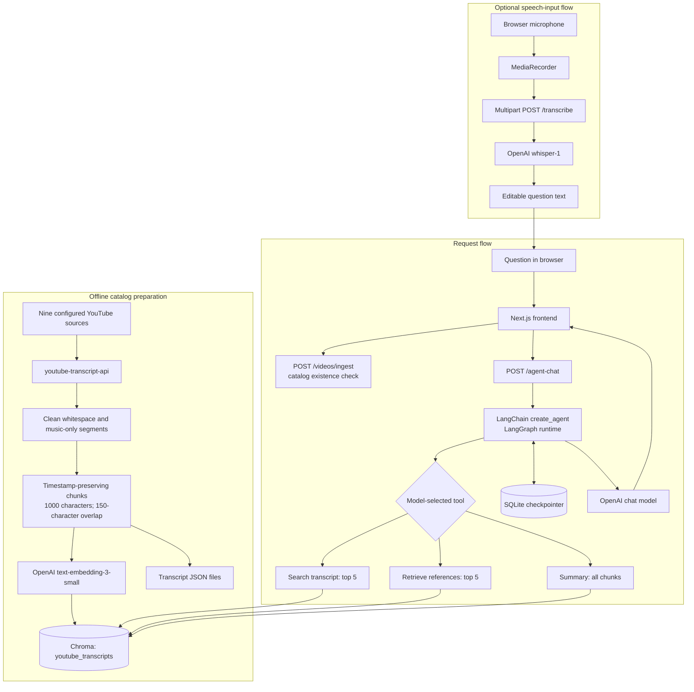

# Architecture Explained

## Verified system flow

The offline builder can fetch transcripts, process them and populate Chroma. The online `/videos/ingest` endpoint does not run that ingestion process; it validates the URL and checks for existing chunks.

## Ingestion and representation

`backend/scripts/build_video_catalog.py` declares nine source IDs and titles. It calls `fetch_youtube_transcript`, cleans segments, groups them into chunks, saves transcript JSON, deletes previous index records for the selected IDs, and adds refreshed chunks. By default it refreshes the full catalog; `--video-ids <id> ...` refreshes only the requested catalog entries, preserving other indexed videos. Transcript fetching first looks for requested language(s), then tries an available transcript and translation where possible. If there are no usable transcript segments, the builder raises an error.

The three wellness videos are now listed in the frontend and catalog builder and have been indexed in a local Chroma database. The local database and the newly generated transcript files are ignored by Git; the new videos will not work on the deployed app until the deployed backend has access to their indexed records.

`clean_segments` normalizes whitespace, removes empty text and isolated musical-note markers, and retains original segment indices and timestamps. `create_chunks` groups whole segments up to a default 1000-character target and carries trailing segments up to a 150-character overlap. Since segments are indivisible, a chunk can exceed the target when a single segment is longer than the target. Each chunk stores start/end time, segment count, and source segment indices.

`chroma_store.py` uses collection `youtube_transcripts`, local persistence at `backend/storage/chroma_db`, and OpenAI `text-embedding-3-small`. It records video ID, chunk index, timestamps, segment count, and segment indices. The embedding dimensionality is not configured in project source. The local index is ignored by Git and its availability in deployment must not be assumed.

## Query and answer

1. The client loads the selected hard-coded catalog video by posting its YouTube URL to `/videos/ingest`.
2. The service extracts the video ID and returns catalog metadata only if Chroma contains chunks; otherwise it returns a client error indicating the video is unsupported.
3. The client sends the selected video ID, a conversation ID, and question to `/agent-chat`.
4. FastAPI validates request lengths and calls `generate_agent_answer`.
5. Agent context passes the current video ID to each tool; tool functions cannot accidentally omit it when invoking the underlying video-specific operations.
6. The model may select transcript search, reference retrieval, or a full-video summary. Search and reference tools request the top five semantic matches for that video. Summary retrieves all video chunks in chronological order.
7. The agent result is returned as text for display in the chat.

RAG is appropriate because it provides relevant passages from the selected video's transcript at question time. Vector search compares embeddings, enabling semantic rather than exact-word matching. It is not a truth guarantee: retrieval can miss evidence, summaries can omit nuance, and model-generated citations are not checked by a separate verifier.

## LangChain and LangGraph

- **LangChain** is used for model/embedding adapters, tool decorators, documents, Chroma integration, and the `create_agent` API.
- **LangGraph** underpins the agent execution/checkpointing setup. The project supplies a SQLite checkpointer but does not define a custom graph with named nodes and explicit edges.
- Tool choice is requested from the model through the agent interface, not hardcoded in the HTTP route. The user-facing endpoint still always invokes the agent, and each available tool is limited to the currently selected video.

## Conversation memory

The agent service stores checkpoints through `SqliteSaver` at `backend/storage/agent_checkpoints.sqlite`. It forms `thread_id` as `<conversation_id>:<video_id>`. In the browser, `conversation_id` is the constant `web-<video_id>`. The frontend clears its visible message list when the selected video changes, but that does not necessarily erase server-side checkpoint history. A persistent shared deployment disk and stronger per-user session separation are not verified.

## Speech input

The browser uses `getUserMedia` and `MediaRecorder`, stops microphone tracks after capture, uploads multipart audio, and inserts returned text in the question input for review. The endpoint rejects empty recordings and recordings over 25 MiB; OpenAI errors are surfaced as a gateway error. It transcribes the user's question in English using `whisper-1`.

This should not be confused with YouTube transcript ingestion. The separate `transcribe_youtube_audio` helper downloads a video's audio with `yt-dlp` and invokes Whisper for timestamped segments, but the live catalog service does not call it.

## API and deployment boundaries

The frontend hardcodes a Render API origin. The FastAPI CORS allowlist includes localhost and the given Vercel origin. The repository has no observed Render/Vercel deployment manifest in the inspected root. The live frontend URL is owner-supplied. Production health, data provisioning, TLS settings, disk persistence, and API error rates require deployment-side verification.

## Architectural limitations and improvement opportunities

- Catalog seeding is operationally separate from the runtime API.
- Local Chroma and SQLite persistence require explicit deployment volume decisions.
- Search results are selected-video scoped; cross-video search would need a different tool/context and UI.
- Responses are rendered as text; structured citation objects and validated clickable timestamp links are not implemented.
- Summarization sends all chunks for the selected video; very long transcripts may exceed practical model context or cost limits.
- No auth, rate-limiting, usage budget, or session ownership layer is evident in the inspected application code.
