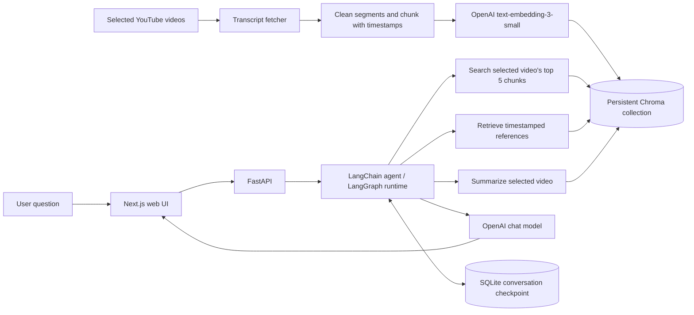

# THE PERFORMANCE LAB

**Explore sports science through questions grounded in selected YouTube videos.**

> **Documentation status:** This is a proposed README, not a replacement for the repository's existing `README.md`. It distinguishes implemented source changes from indexed/deployed behavior that still needs to be confirmed.

## Overview

THE PERFORMANCE LAB is a web-based video knowledge assistant. A user selects one of nine catalogued sports-science and wellness videos and asks questions about its spoken content. The Python API uses video-filtered semantic search and a LangChain/LangGraph agent with transcript-search, reference, and summary tools to form responses. The web client also records a spoken question and sends it to an OpenAI transcription endpoint before the user reviews and submits the text.

The current scope is educational exploration of a small, curated video collection. It is not a medical, diagnostic, or individualized treatment service.

**Live links supplied by the project owner:** [Web application](https://ai-video-knowledge-assistant.vercel.app/). The frontend source sends API requests to a Render-domain URL; deployment health and operational configuration have not been independently verified in this repository audit.

## Problem, audience, and objectives

Long videos can be difficult to search and revisit. The application provides a conversational interface for exploring selected sports-science material, locating transcript passages, and requesting a summary.

Intended users include students, athletes, coaches, and curious viewers seeking an accessible way to revisit educational video content. This audience is inferred from the product framing and video selection, not validated user research.

Project objectives evident in the implementation:

- Make a fixed sports-science video library searchable by natural-language questions.
- Keep question answering scoped to the selected video.
- Preserve conversation turns through a persistent LangGraph SQLite checkpointer.
- Offer optional microphone input for composing a question.
- Provide a test/evaluation code path using Pytest and LangSmith.

## Application features

| Feature | Evidence-based status |
|---|---|
| Nine-video selection and chat UI | **IMPLEMENTED IN SOURCE** in `frontend/src/app/page.tsx`; the three new wellness videos still need deployment and indexing in the deployed backend. |
| Transcript-aware semantic retrieval | **IMPLEMENTED IN CODE** in `backend/app/retrieval/retriever.py`; the three new wellness videos were indexed and smoke-tested locally. |
| Three agent tools (search, summary, references) | **VERIFIED IMPLEMENTED** in `backend/app/agents/agent_tools.py`. |
| Microphone recording and transcription | **IMPLEMENTED IN CODE**; owner-shared teacher feedback reports that Whisper voice input was tested live on an earlier version/deployment. |
| Preloaded video lookup | **VERIFIED IMPLEMENTED** in `backend/app/services/video_service.py`; new videos are explicitly not ingested at runtime. |
| Whole-library search | **NOT EXPOSED BY THE CHAT FLOW**: retrieval supports an optional video filter, but agent tools always use the selected video. |
| Video-frame understanding | **NOT IMPLEMENTED**; the prompt states the assistant can analyze spoken content only. |

## Video knowledge base

The frontend and catalog-build script now list nine videos. Six original transcript JSON files are tracked; the three newly added wellness transcripts and their Chroma records were generated locally and are not tracked by Git. The expanded topics include exercise and the brain, cardiovascular exercise, injury prevention, recovery, strength, sleep, nutrition, hydration, stress, and mental wellness. Titles and IDs are declared in `frontend/src/app/page.tsx` and `backend/scripts/build_video_catalog.py`.

The transcript-fetching code uses `youtube-transcript-api`, with language selection and fallback to an available transcript or translation. The catalog-build script cleans and chunks fetched transcript segments, then writes transcript JSON and adds chunks to Chroma. At runtime, however, the video service looks up a preloaded Chroma collection and rejects videos that are not already indexed. The tracked transcript JSON files are not read by this runtime lookup.

## Technology choices

| Technology | Role in this project | Reason / limitation |
|---|---|---|
| Python | Backend and evaluation language | Connects the API, ingestion, retrieval, agent and evaluation modules. |
| FastAPI, Pydantic, Uvicorn | HTTP API, request validation, ASGI serving | Small service surface with typed request constraints and generated API docs. |
| LangChain | OpenAI chat/embedding integrations, tools, agent creation | Connects the model to retrieval and task tools; model/tool decisions remain probabilistic. |
| LangGraph | Agent runtime/checkpoint integration | `create_agent` is configured with a SQLite checkpointer; there is no hand-authored multi-node graph in this code. |
| OpenAI | Chat model, embeddings, speech-to-text | Model defaults to `gpt-5.4-mini`; embeddings use `text-embedding-3-small`; audio uses `whisper-1`. API access and cost are required. |
| ChromaDB (`langchain-chroma`) | Persistent local vector store | Stores transcript chunks and metadata for semantic search. A local index was created for the three new videos; the index is ignored by Git. |
| SQLite (`langgraph-checkpoint-sqlite`) | Agent conversation checkpoints | Checkpoint file is created under `backend/storage`; persistence across deployed instances depends on the hosting filesystem and is unverified. |
| `youtube-transcript-api`, `yt-dlp` | Transcript retrieval and catalog audio fallback | Used by the catalog builder and transcript modules; runtime ingestion is disabled. |
| Next.js, React, TypeScript, Tailwind CSS | Browser application | Provides the video library, question form, and microphone controls. No frontend test script is configured. |
| Vercel, Render | Deployment targets indicated by user-provided live URL, frontend API URL, and CORS allowlist | Deployment manifests and runtime status were not found/verified in the inspected repository. |
| Pytest, HTTPX | Backend tests and FastAPI test client | Tests are present, but no test run could be completed in this environment. |
| LangSmith | Optional tracing and remote dataset evaluation | Evaluation scripts exist; teacher feedback identifies systematic retrieval and answer-quality results as the main remaining gap. |
| Git/GitHub | Source control and project hosting | Repository history is available; no CI workflow was observed in the inspected tree. |

## Architecture



The ingestion arrows describe the offline catalog-building script. The deployed/runtime ingestion endpoint does not fetch arbitrary YouTube content; it checks that the video already exists in Chroma.

### Retrieval-augmented generation (RAG)

RAG first searches stored transcript chunks and supplies relevant text to a model rather than relying only on the model's general training. Embeddings represent text as vectors so semantically similar questions and passages can be matched even when they use different words. Chroma stores those vectors with video IDs, chunk numbers, and timestamps.

The retrieval helper requests five similarity-search results by default and can filter by `video_id`. Agent tools pass the selected video ID, so normal agent questions are video-specific. The search tool returns chunk text and metadata; the references tool formats timestamps; the summary tool loads all chunks for the video and sends the transcript to the configured OpenAI model.

RAG can make answers more traceable to a source, but it does not guarantee factual correctness. The system prompt directs the agent to use transcript evidence and acknowledge insufficient evidence. The UI displays the model's plain text response; there is no separate citation-verification layer.

### Agent, tools, frameworks, and memory

The agent is created in `backend/app/agents/agent.py` using LangChain's `create_agent`, an OpenAI chat model, three tools, an `AgentContext`, and a checkpointer. It can select tools based on the request, so tool selection is agent-driven rather than fixed endpoint routing. This is not a custom, explicitly drawn LangGraph workflow: no project-authored nodes/edges are declared.

LangChain supplies model, tool, and agent abstractions. LangGraph supplies the agent execution/checkpoint runtime underneath this setup. Conversation identity is formed as `conversation_id:video_id`; the frontend currently uses the constant `web-<video_id>` for that video's conversations. This may combine sessions for the same video across browser visits when the same SQLite file persists. Hosting persistence and multi-user isolation are not established.

### Voice question path

1. The browser requests microphone access and records audio with `MediaRecorder`.
2. On stop, it uploads a WebM/MP4 blob to `POST /transcribe`.
3. FastAPI checks for empty input and a 25 MiB maximum.
4. The backend calls OpenAI `whisper-1` for English transcription.
5. The transcribed text is placed in the question field for user review; the user still submits it as a normal chat message.

This is speech input for the user's question, not video audio ingestion. Separately, `yt-dlp` and Whisper are used in a YouTube audio transcription function, but runtime video ingestion currently uses the prebuilt catalog and does not invoke that fallback.

### Frontend/backend communication

The browser sends JSON requests to `/videos/ingest` and `/agent-chat`, and multipart form data to `/transcribe`. The frontend hardcodes the Render URL in `frontend/src/app/page.tsx`; the API CORS allowlist includes local development origins and the Vercel URL. No configurable frontend API environment variable is present in the inspected page.

## Local setup

### Requirements

- Python with pip.
- Node.js and npm for the frontend.
- OpenAI API access for model calls and embeddings.
- A populated local Chroma catalog for successful video queries.

### Backend

From the repository root in PowerShell:

```powershell
cd backend
python -m venv .venv
.\.venv\Scripts\Activate.ps1
pip install -r requirements.txt
cd ..
Copy-Item .env.example .env
```

Set `OPENAI_API_KEY` in the root `.env`. The code defaults `OPENAI_MODEL` to `gpt-5.4-mini`; it is not included in `.env.example`. The configuration module raises an error if `OPENAI_API_KEY` is absent.

The Chroma index is not tracked by Git. `backend/scripts/build_video_catalog.py` fetches configured YouTube transcripts and creates the local index, making external requests and changing local storage. To refresh only the three wellness entries while preserving other indexed videos, run this from `backend` after the updated code is available in that environment:

```powershell
python -m scripts.build_video_catalog --video-ids h2aWYjSA1Jc mLn2X2JSrbg RcGyVTAoXEU
```

The command requires the backend's OpenAI credentials and access to a writable persistent Chroma directory. Coordinate with the deployment owner before running it on the production service. Do not expect `/videos/ingest` to add an arbitrary new video.

Start the API from `backend`:

```powershell
python -m uvicorn app.main:app --reload
```

API docs: `http://127.0.0.1:8000/docs`.

### Frontend

In another terminal:

```powershell
cd frontend
npm ci
npm run dev
```

The current frontend points to the Render API URL in source. Local frontend-to-local backend testing requires changing/configuring that URL; configuration support is a recommended improvement, not implemented.

### Environment variable names

Names found in code or `.env.example` (never commit values):

- `OPENAI_API_KEY` — required by backend configuration.
- `OPENAI_MODEL` — optional model override in code; not listed in `.env.example`.
- `LANGCHAIN_TRACING_V2`, `LANGCHAIN_API_KEY`, `LANGCHAIN_PROJECT` — optional LangSmith/LangChain tracing settings in `.env.example`.
- `LANGSMITH_API_KEY` — read by the LangSmith dataset creation script; distinct from `LANGCHAIN_API_KEY`.
- `APP_ENV` — appears in `.env.example`; its use is not evident in inspected application code.

The split between `LANGCHAIN_API_KEY` and `LANGSMITH_API_KEY` should be reconciled before documenting a single tracing setup.

## API

| Method | Route | Purpose |
|---|---|---|
| GET | `/` | Basic service response |
| GET | `/health` | Health response |
| POST | `/videos/ingest` | Validate a YouTube URL and confirm video exists in the preloaded catalog |
| POST | `/agent-chat` | Run an agent turn for a video/conversation ID |
| POST | `/transcribe` | Transcribe an uploaded user audio recording |

The names and behavior are from `backend/app/main.py`; a health response alone does not establish that the vector database or external AI service is available.

## Deployment

The live frontend URL is supplied in the project brief. Source points the browser to `https://ai-video-knowledge-assistant.onrender.com`; the API CORS list permits the Vercel site URL. This is evidence of intended hosting topology, not proof of deployment configuration, current uptime, backend disk persistence, or a successful production smoke test. No Dockerfile, Render manifest, or Vercel configuration file was found at repository root in this audit.

Before relying on deployed chat for the new videos, verify that the backend has all nine matching Chroma records and a persistent writable filesystem for the Chroma index and SQLite checkpointer. Confirm environment variables in the hosting dashboards without putting their values in source or documentation.

## Testing and evaluation

Backend tests under `backend/tests/` cover API responses and validation, transcript URL parsing, segment cleaning/chunking, retrieval filtering, vector-store document metadata, tool context, and retrieval metric math. No dedicated audio-transcription or memory persistence tests and no frontend test script were found.

Teacher feedback supplied by the owner for an earlier version/deployment reports **44 passing tests** and live-tested Whisper voice input. On 2026-11-10, the updated code passed **48 backend tests** in an isolated Python 3.12 environment using a dummy API key; no real OpenAI calls were made in those unit tests. The three new videos were subsequently indexed locally, and a real semantic search and agent question were smoke-tested for each using OpenAI. These checks do not establish answer quality or deployed operation. No LangSmith evaluation scores were provided or run during this audit.

Evaluation code currently defines a 12-question dataset across the original six videos, local precision-at-k evaluation, LangSmith retrieval hit-rate/precision evaluators, and LLM-judge checks for correctness, relevance, and groundedness. Add reviewed reference answers and relevant chunk labels for the wellness videos after indexing before claiming evaluation coverage across all nine. See [TESTING_AND_EVALUATION.md](./TESTING_AND_EVALUATION.md).

## Limitations and responsible use

- The supported library is curated and fixed; runtime ingestion of arbitrary videos is disabled.
- Responses use spoken transcript text only; visual analysis is unsupported.
- Transcript quality, language/translation, and missing content can limit retrieval.
- Citations are generated in natural-language responses and are not independently validated.
- Wellness material can be incomplete or context-specific. Treat it as general education, not personalized medical advice; seek qualified professionals for health concerns.
- Avoid entering sensitive health or personal information. The project is not shown to provide clinical privacy or safety controls.
- Hosting persistence, request rate limiting, authentication, and operational monitoring were not verified.

## Roadmap: wellness expansion

| Priority | Proposal | Benefit | Main considerations |
|---|---|---|---|
| Essential | Run systematic retrieval and answer-quality evaluations; confirm current deployment/index setup and educational/medical boundary language | Measurable quality and a reliable, appropriately scoped demo | Teacher feedback identifies evaluation as the main remaining gap; capture experiment results and recheck deployment behavior. |
| Quick | Externalize API URL, show source passages as links, add suggested prompts and feedback | Easier local setup and more transparent use | Avoid implying a citation is verified when it is only model-generated. |
| Next | Add curated sleep, nutrition/hydration, stress, and general wellness videos with source review | Broader educational coverage | Source quality, conflicting guidance, health misinformation, and scope control. |
| Future | Cross-video search, topic filters, multilingual query UX, richer evaluation and out-of-scope behavior | Better discovery and quality measurement | Data model/tool changes, evaluation coverage, cost, and user testing. |

Detailed proposals are in [WELLNESS_EXPANSION_ROADMAP.md](./WELLNESS_EXPANSION_ROADMAP.md).

## Development evidence and project deliverables

The available commit log shows implementation milestones from initial RAG setup through LangGraph, transcript handling, a curated frontend/catalog, microphone transcription, and LangSmith evaluation. It does not record personal motivations, obstacles beyond commit subjects, or measured deployment outcomes. The current [README.md](../README.md) contains statements that conflict with current code (notably automatic speech-to-text fallback and general YouTube ingestion); retain it until this draft is reviewed and approved.

Repository deliverables include backend and frontend source, six transcript JSON files, tests, catalog-building and evaluation scripts, and this proposed documentation package. A final presentation structure is in [PRESENTATION_OUTLINE.md](./PRESENTATION_OUTLINE.md).

## Acknowledgments

The catalog references educational videos from TED-Ed, Wendy Suzuki/TED, Institute of Human Anatomy, Rehab 2 Perform, Tahoe Forest Health System, and Experts in Sport/Loughborough University. Video ownership remains with the respective creators. Add personal acknowledgments, course/mentor credits, and asset attributions only after confirming the exact wording.
